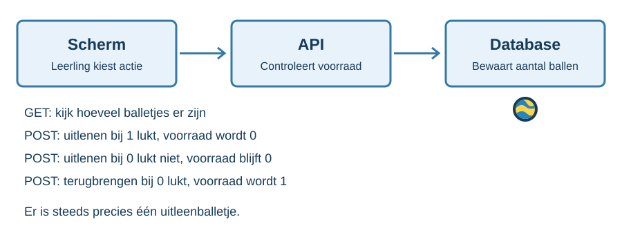
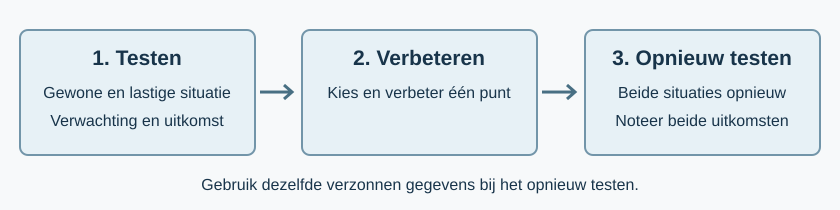

# SE 2

**4H, 4V en 5V (Backend)**  
**5H en 6V (Product)**

**Hoe verbeter je met je team één functie, zodat een gebruiker één taak kan uitvoeren?**

Werk in jullie bestaande project. Lever één link naar de README.md van jullie eigen team in. Leg in je mondeling jouw eigen werk uit.

1. Kies en ontwerp
2. Bouw en test
3. Leg het werk vast
4. Laat zien en lever in

| Wanneer | Wat laat je zien of lever je in? |
|---|---|
| 27 november | Ontwerp en twee situaties. |
| 4 december | Werkende versie, twee eerste tests en één verbeterpunt. |
| 8 december, 16.00 uur | Verbetering, twee hertests en één link naar de README.md van jullie eigen team via het Google Formulier op de SE 2-startpagina. |
| 10 tot 17 december | Wijs in je mondeling één stuk eigen werk aan en leg uit wat je deed en hoe het werkt. |

## Beoordeling

**Groepswerk: 50 punten**

| Criterium | Maximaal |
|---|---:|
| Werking | 15 punten |
| Ontwerp | 10 punten |
| Opbouw | 5 punten |
| Testen en verbeteren | 10 punten |
| Klantwaarde | 10 punten |

**Mondeling: 50 punten**

| Criterium | Maximaal |
|---|---:|
| Eigen bijdrage | 20 punten |
| Technisch begrip | 20 punten |
| Reflectie en samenwerking | 10 punten |

Lees de [volledige rubric](rubric.html).

## Wat is een functie?

Een productfunctie helpt de gebruiker iets doen, zoals een bal uitlenen. Een programmeerfunctie voert een taak uit: ze kan gegevens ontvangen, daarmee iets doen en een uitkomst geven. Denk aan een machine: er gaat iets in en er komt iets uit.


Bron: [Kismalac, Wikimedia Commons, CC0](https://commons.wikimedia.org/wiki/File:FunctionMachine.svg).

## 1. Kies en ontwerp
Open jullie project op Github. Kies één taak voor een gebruiker. Kopieer en vul dit schema in het Issue van die functie. Een bestaand Issue of gedeeld document mag ook. Gebruik één schema.

```text
Gebruiker en taak:
Gegevens en regel:
Keuze en waarom:
Gewone situatie → verwachte uitkomst:
Lastige situatie → verwachte uitkomst:
```

Gebruikt jullie Backend een API? Zet bij beide situaties ook de GET- of POST-aanvraag en het verwachte JSON-antwoord.

**Ingevuld voorbeeld sportclub**

| Veld | Voorbeeld |
|---|---|
| Gebruiker en taak | Vrijwilliger leent een voetbal. |
| Gegevens en regel | Code B01. Bij 2 ballen: leen 1. Bij 1: reserveer. |
| Keuze en waarom | Toon voorraad en melding, zodat de vrijwilliger weet wat kan. |
| Gewoon | Voorraad 2 → 1 bal uitgeleend. |
| Lastig | Voorraad 1 → blijft 1; toon reserveringsmelding. |

**Backendvoorbeeld met API**


```text
GET → {"code":"B01","voorraad":2}
POST {"code":"B01"} → {"uitgeleend":true,"voorraad":1}
POST {"code":"B01"} bij 1 → {"uitgeleend":false,"voorraad":1,"melding":"Laatste bal gereserveerd"}
POST {"code":"B01"} bij 0 → {"uitgeleend":false,"voorraad":0,"melding":"Geen ballen beschikbaar"}
```

## Bewijsroute

| Onderdeel | Waar staat het? |
|---|---|
| Ontwerp | Issue van de gekozen functie. |
| Tests | Issue ‘Tests’, bestaand testissue of één gedeeld document. |
| Code | Commit met de geteste versie. |
| Bewijs en inlevering | Links in de README.md van jullie team. |

Verwijs naar bestaand bewijs. Houd het op één plek; maak geen dubbele administratie.

## 2. Bouw en test
Product: laat de gebruiker de taak van begin tot eind doen. Backend: laat de vraag van het scherm zien, welke gegevens je leest of wijzigt, welke regel beslist en welk antwoord terugkomt. Gebruik een database; Google Sheets mag. Een aparte databaseserver hoeft niet. Maak één bewerking ook zonder het scherm testbaar.



Zet je testbewijs op de plek bij Tests in de bewijsroute. Noteer bij beide situaties de verwachting en eerste uitkomst, het verbeterpunt en beide nieuwe uitkomsten.

## 3. Leg het werk vast
Zet in de README.md van jullie eigen team: het klantprobleem, wat de functie oplevert en wat nog ontbreekt; links naar het ontwerp, de tests, de code, gebruikt werk uit les 1 tot 4 en de geteste commit of tag. Schrijf onder ‘Zo probeer je het’ hoe iemand de geteste versie binnen twee minuten opent en probeert. Verwijs naar het bestaande bewijs; kopieer het niet opnieuw.

Kies een mogelijke klant of doelgroep buiten jullie eigen kring en die van de docent. Leg uit wie waarvoor zou willen betalen en waarom. Klantcontact is vrijwillig. Wil je mailen, vraag dan eerst toestemming in jullie Issue. Een reactie of verkoop levert op zichzelf geen hoger niveau op.

Controleer of de docent toegang heeft tot de repository en gelinkte documenten. Zet geen herkenbare persoonsgegevens in openbare bestanden, Issues of commitberichten.

## 4. Laat zien en lever in

Volg de planning bovenaan. Lever de link naar de README van jullie team in.
